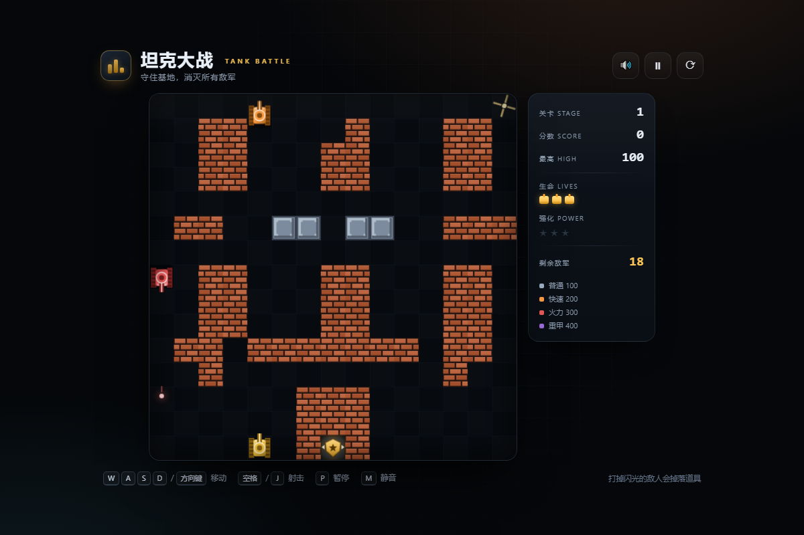

# 坦克大战 · Tank Battle

一款用 **纯 HTML5 Canvas + 原生 JavaScript** 编写的经典坦克大战小游戏。零依赖、零构建，打开网页即可开玩。



## 在线试玩

- 游戏主页：<https://stayyyyy-not.github.io/tank-battle/>
- 直接开局：<https://stayyyyy-not.github.io/tank-battle/#play>

## 玩法

守住画面底部的基地（金鹰），消灭所有敌军即可过关。

- 砖墙可以被子弹打穿，钢墙只有满级火力才能击毁，河流无法通过，树林会遮挡视线。
- 基地被摧毁，或者生命耗尽，游戏结束。
- 每 4 个敌人中会有 1 个带金色光环，击毁后必定掉落道具。
- 共 3 个关卡，通关后显示胜利。

## 操作

| 操作 | 键盘 | 触屏 |
| --- | --- | --- |
| 移动 | `W A S D` / 方向键 | 屏幕左下方向键 |
| 射击 | `空格` / `J` | 屏幕右下「发射」 |
| 暂停 | `P` / `Esc` | 顶栏暂停按钮 |
| 静音 | `M` | 顶栏声音按钮 |

## 道具

| 道具 | 效果 |
| --- | --- |
| 🛡 护盾 | 9 秒无敌护盾 |
| ★ 强化 | 提升火力等级（最多 3 级：更快射速、更快子弹、双发、可击毁钢墙） |
| 💣 炸弹 | 立即摧毁场上所有敌人 |
| ＋ 生命 | 增加 1 条生命 |

## 敌军

| 类型 | 颜色 | 生命 | 分值 | 特点 |
| --- | --- | --- | --- | --- |
| 普通 | 银灰 | 1 | 100 | 常规速度 |
| 快速 | 橙色 | 1 | 200 | 移动速度极快 |
| 火力 | 红色 | 1 | 300 | 子弹速度极快 |
| 重甲 | 紫色 | 4 | 400 | 需要命中 4 次 |

## 特性

- 15 × 15 的三张关卡地图，包含砖墙 / 钢墙 / 河流 / 树林四种地形
- 敌军 AI：随机游走、向基地施压、与目标对齐时开火、被阻挡时转向
- 可破坏地形、子弹对撞、装甲伤害、重生无敌时间
- 粒子爆炸、冲击波、屏幕震动、WebAudio 合成音效（无需音频文件）
- 分数、关卡、生命、强化等级、本地最高分（`localStorage`）
- 键盘 + 触屏双操作，适配桌面与手机
- 暂停 / 静音 / 重新开始 / 页面失焦自动暂停

## 本地运行

直接双击 `index.html` 即可游玩。

也可以启动一个本地静态服务器：

```bash
python -m http.server 8000
# 打开 http://localhost:8000
```

小技巧：打开 `index.html#play` 可以直接跳过开始界面进入游戏。

## 目录结构

```
.
├── index.html          # 页面结构与 HUD
├── style.css           # 界面样式与响应式布局
├── game.js             # 游戏逻辑、AI、渲染与音效
├── favicon.svg         # 网站图标
├── docs/screenshot.png # 游戏截图
└── LICENSE             # MIT
```

## 开发

游戏状态机：`menu → playing → paused / levelclear / victory / gameover`。

打开 `index.html?debug#play` 后可在浏览器控制台通过 `window.__TANK_DEBUG__` 访问运行时状态，便于调试。

## 许可证

[MIT](LICENSE)
